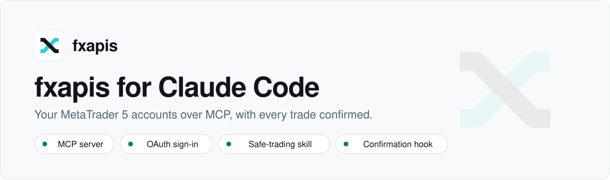

<div align="center">

<picture>
  <source media="(prefers-color-scheme: dark)" srcset=".github/assets/banner-dark.svg">
  <source media="(prefers-color-scheme: light)" srcset=".github/assets/banner-light.svg">
  
</picture>

**Read and trade your MetaTrader 5 accounts from Claude Code, with every trade confirmed.**

[Website](https://fxapis.com) · [Docs](https://docs.fxapis.com/guides/claude-plugin) · [MCP guide](https://docs.fxapis.com/guides/mcp) · [Status](https://status.fxapis.com) · [Support](mailto:support@fxapis.com)

[](https://github.com/FXapis/fxapis-claude-plugins/actions/workflows/ci.yml)
[](LICENSE)
[](https://code.claude.com/docs/en/plugins)
[](https://modelcontextprotocol.io)
[](https://docs.fxapis.com/guides/claude-plugin)
[](https://status.fxapis.com)
[](https://github.com/FXapis/fxapis-claude-plugins/stargazers)

</div>

---

This is the plugin marketplace for [fxapis](https://fxapis.com), the hosted MetaTrader 5 API. Its one plugin, `fxapis`, connects Claude Code to the fxapis MCP server, teaches Claude how to trade MT5 carefully, and adds a hook that makes you confirm every trade and refuses live accounts until you allow them.

```text
/plugin marketplace add FXapis/fxapis-claude-plugins
/plugin install fxapis@fxapis
```

> [!WARNING]
> **Orders placed through fxapis are real orders at your broker.** On a live account they are real money. Start with a broker demo account, sign in read-only first, and read the [safety model](#safety-model) before you let Claude trade.

## Table of contents

- [Quick start](#quick-start)
- [What's inside](#whats-inside)
- [How sign-in works](#how-sign-in-works)
- [Safety model](#safety-model)
- [Configuration](#configuration)
- [Example prompts](#example-prompts)
- [Use it outside Claude Code](#use-it-outside-claude-code)
- [Troubleshooting](#troubleshooting)
- [Development](#development)
- [Related fxapis repositories](#related-fxapis-repositories)
- [Contributing](#contributing)
- [Support](#support)
- [License](#license)

## Quick start

You need [Claude Code](https://code.claude.com/docs) and an fxapis account with at least one MT5 account connected in the [console](https://fxapis.com/dashboard). Connecting an MT5 account takes its broker password, so it is done in the console and never through Claude.

**1. Add the marketplace and install the plugin.** Inside Claude Code:

```text
/plugin marketplace add FXapis/fxapis-claude-plugins
/plugin install fxapis@fxapis
```

Or from your shell:

```bash
claude plugin marketplace add FXapis/fxapis-claude-plugins
claude plugin install fxapis@fxapis
```

**2. Sign in.** Ask for something that needs fxapis, such as `/fxapis:status`. The first tool call opens fxapis's sign-in page in your browser. Approve read access, and turn on trading only for the accounts you want.

**3. Check your accounts.**

```text
/fxapis:status
/fxapis:positions
```

To update later, run `/plugin marketplace update fxapis`.

## What's inside

| Component | Name | What it does |
|---|---|---|
| MCP server | `fxapis` → `https://api.fxapis.com/mcp` | Accounts, positions, orders, deals, quotes, market hours, margin and profit calculations, and trading tools. Streamable HTTP, with OAuth sign-in or an optional API key. [Tool reference](https://docs.fxapis.com/guides/mcp#tools). |
| Skill | [`trading-mt5-safely`](plugins/fxapis/skills/trading-mt5-safely/SKILL.md) | Demo before live; one explicit yes per trade; a fresh idempotency key per action; never resending an unresolved order; checking the market is open; sizing against free margin; reducing risk first in a drawdown. References cover the [order lifecycle](plugins/fxapis/skills/trading-mt5-safely/order-lifecycle.md), [multi-account orders](plugins/fxapis/skills/trading-mt5-safely/multi-account-orders.md) and every [error code](plugins/fxapis/skills/trading-mt5-safely/error-codes.md). |
| Command | [`/fxapis:status`](plugins/fxapis/commands/status.md) | Your accounts in one table (label, login, server, environment, state), and what to fix for any account that needs you. Calls no tool that trades. |
| Command | [`/fxapis:positions`](plugins/fxapis/commands/positions.md) | Open positions across every ready account, with balance, equity and P/L per account and in total per currency. Calls no tool that trades. |
| Command | [`/fxapis:connect-help`](plugins/fxapis/commands/connect-help.md) | Signing in, live trading, API keys and revoking access, explained without calling any tool. |
| Hook | [`PreToolUse` → `confirm-trade.mjs`](plugins/fxapis/hooks/hooks.json) | Asks you before every fxapis trade, even in auto-accept mode, and refuses trades on live accounts while `allowLiveTrading` is off. See [Safety model](#safety-model). |

```text
.
├── .claude-plugin/marketplace.json        # the "fxapis" marketplace
└── plugins/fxapis/
    ├── .claude-plugin/plugin.json         # manifest and userConfig
    ├── .mcp.json                          # the fxapis MCP server
    ├── commands/                          # status, positions, connect-help
    ├── hooks/hooks.json                   # PreToolUse matcher for the seven trade tools
    ├── scripts/confirm-trade.mjs          # the confirmation hook
    └── skills/trading-mt5-safely/         # SKILL.md and its references
```

## How sign-in works

- **OAuth on first use.** With no API key set, the first fxapis tool call opens fxapis's sign-in page in your browser. Sign-in is OAuth 2.1 with PKCE, as the MCP authorization spec describes.
- **You choose what Claude may do.** Read access (accounts, positions, orders, deals, figures, quotes) is always included. Trading is off by default; turn it on per account. It needs two-factor on your fxapis account, and you can also set a maximum order size and a number of orders a day.
- **Revocable at any time.** Every connected app is listed on the [API keys page](https://fxapis.com/dashboard/keys) under **Connected apps**. **Revoke** ends its access on its next request.
- **An API key is optional.** For an agent that runs unattended, [create a key](https://fxapis.com/dashboard/keys) with only the scopes it needs and set it as the plugin's `api_key` option. The plugin sends it as the `X-API-Key` header and stores it as a sensitive value.

## Safety model

Several layers stand between a prompt and an order. The first two are enforced by fxapis on every call, whatever the model decides.

1. **What you allowed.** A read-only connection cannot trade. A trading connection can change only the accounts you picked, within the limits you set. An API key can do only what its scopes allow.
2. **Two-factor for trading.** Letting an app trade requires two-factor on your fxapis account.
3. **The confirmation hook.** It runs before each of the seven trade tools: `place_market_order`, `place_pending_order`, `close_position`, `modify_position`, `cancel_order`, `place_multi_account_order` and `cancel_multi_account_order`.
   - It always answers **ask**, so Claude Code shows a confirmation dialog even in auto-accept mode, with one line saying what will happen, for example `fxapis: buy 0.10 lots EURUSD at market on account … — demo`.
   - If fxapis has reported the account as **live** in this session, and `allowLiveTrading` is off, the trade is **denied**.
   - An account not yet listed in the session is marked "demo or live not known yet" and asked about, never assumed safe.
   - It learns each account's environment only from fxapis's own `list_accounts`, `get_account` and `get_account_overview` results in the session transcript, never from user text or other tools' output. Once an account is seen as live, it stays live for the session.
   - If anything goes wrong while checking, it still asks.
4. **The skill.** It tells Claude to suggest a demo run first, name the environment ("LIVE account 5012345") in every proposal, wait for an explicit yes per trade, and never resend an order whose outcome is unknown. This shapes behaviour; layers 1 to 3 enforce.

fxapis has no simulated market: broker demo accounts are how you test.

## Configuration

The plugin declares two options in [`plugin.json`](plugins/fxapis/.claude-plugin/plugin.json). Set them with `/plugin` → **fxapis** → **configure**.

| Option | Type | Default | What it does |
|---|---|---|---|
| `api_key` | string, sensitive | empty | **fxapis API key (optional).** Leave empty to sign in to fxapis in your browser on first use. Set an `fx_live_…` key only for agents that run unattended. |
| `allowLiveTrading` | boolean | `false` | **Allow trades on live accounts.** Off: trades on accounts fxapis reports as live are refused. Demo accounts trade, each after you confirm it. |

Turning on `allowLiveTrading` does not skip confirmation: every trade, demo or live, is still asked about.

## Example prompts

- "Which of my MT5 accounts are online, and what positions are open on each?"
- "How much margin would 0.5 lots of XAUUSD need on my demo account?"
- "Is the EURUSD market open on my demo account right now?"
- "Bring all my accounts online, then tell me when they are ready."
- "Buy 0.01 lots of EURUSD on the demo account with a 20-pip stop."
- "Move the stop loss on my gold position to break-even."
- "Did anything go wrong with today's orders? Show me any that are still `unknown`."

Prompts that trade need a connection with trading turned on for that account, and each one stops at the confirmation dialog.

## Use it outside Claude Code

There is no one-click link that adds a plugin marketplace to Claude Code or a custom connector to claude.ai; use the commands and steps below.

### claude.ai and Claude Desktop

1. Open **Customize → Connectors → Add custom connector**. On Team and Enterprise plans, an Owner adds it under **Organization settings → Connectors**.
2. **Remote MCP server URL:** `https://api.fxapis.com/mcp`. Leave the OAuth client fields empty.
3. Click **Connect** and sign in to fxapis in the window that opens.

For the skill, download [trading-mt5-safely.zip](https://docs.fxapis.com/downloads/trading-mt5-safely.zip) and upload it under **Settings → Capabilities → Skills**. The hook and commands are Claude Code features and are not part of the connector. Full steps: [docs.fxapis.com/guides/claude-plugin](https://docs.fxapis.com/guides/claude-plugin).

### Claude Code without the plugin

```bash
claude mcp add --transport http fxapis https://api.fxapis.com/mcp
```

Then run `/mcp`, choose **fxapis** and **Authenticate**. The hook also matches a server added this way under the name `fxapis`, but only when the plugin is installed.

### VS Code and Cursor

These clients sign in through a `vscode://` or `cursor://` return address, which fxapis does not accept yet, so they connect with an [API key](https://fxapis.com/dashboard/keys) instead. They get the MCP server only, without the skill or the hook.

[](https://vscode.dev/redirect/mcp/install?name=fxapis&inputs=%5B%7B%22type%22%3A%22promptString%22%2C%22id%22%3A%22fxapis-key%22%2C%22description%22%3A%22fxapis%20API%20key%22%2C%22password%22%3Atrue%7D%5D&config=%7B%22type%22%3A%22http%22%2C%22url%22%3A%22https%3A%2F%2Fapi.fxapis.com%2Fmcp%22%2C%22headers%22%3A%7B%22Authorization%22%3A%22Bearer%20%24%7Binput%3Afxapis-key%7D%22%7D%7D)
[](https://cursor.com/en/install-mcp?name=fxapis&config=eyJ1cmwiOiJodHRwczovL2FwaS5meGFwaXMuY29tL21jcCIsImhlYWRlcnMiOnsiQXV0aG9yaXphdGlvbiI6IkJlYXJlciAke2VudjpGWEFQSVNfS0VZfSJ9fQ%3D%3D)

- **VS Code** asks for the key once and keeps it in its secret storage.
- **Cursor** reads it from the `FXAPIS_KEY` environment variable, so set that before starting Cursor.

The configs behind these buttons, and ones for other clients, are in [fxapis-mcp-examples](https://github.com/FXapis/fxapis-mcp-examples) and the [MCP guide](https://docs.fxapis.com/guides/mcp#agents-with-an-api-key).

## Troubleshooting

| Symptom | What to do |
|---|---|
| fxapis tools don't appear | Run `/plugin` and check that **fxapis** is installed and enabled, then `/mcp` to see the server's state. |
| The browser sign-in never opened | Run `/mcp`, choose the fxapis server and **Authenticate**. |
| A trade was refused: "a LIVE account, and live trading is off" | Working as intended. Turn on `allowLiveTrading` under `/plugin` → fxapis → configure if you mean to trade that account. |
| The dialog says "demo or live not known yet" | Run `/fxapis:status` (or ask Claude to list your accounts) first, so the hook knows each account's environment. |
| `MISSING_SCOPE`, or Claude asks you to sign in again before a trade | This connection was not allowed to trade that account. Sign in again with **Trading** on for it, or use a key with the right scopes. |
| An account shows `invalid_credentials`, `needs_2fa`, `needs_certificate` or `trading_disabled` | It needs you, in the [console](https://fxapis.com/dashboard). `/fxapis:status` says what is wrong. |
| `ORDER_UNRESOLVED` | The order may be live at the broker. Do not resend it; ask Claude to check it with `get_order` until it resolves. |
| No confirmation dialog appears before a trade | The hook runs with `node`; make sure Node.js is on your `PATH`. |

More: [docs.fxapis.com/guides/mcp](https://docs.fxapis.com/guides/mcp) and [status.fxapis.com](https://status.fxapis.com).

## Development

Requires Node.js 20 or later.

```bash
npm test                                         # hook, manifest and skill tests (node --test)
claude plugin validate . --strict                # the marketplace
claude plugin validate ./plugins/fxapis --strict # the plugin
claude --plugin-dir ./plugins/fxapis             # try it locally
```

[CI](.github/workflows/ci.yml) runs the same tests and both validations on every push and pull request.

## Related fxapis repositories

| Repository | What it is |
|---|---|
| [`fxapis-mcp-examples`](https://github.com/FXapis/fxapis-mcp-examples) | MCP client configurations for Claude, Cursor, VS Code, the OpenAI and Anthropic APIs |
| [`fxapis-typescript`](https://github.com/FXapis/fxapis-typescript) | The official TypeScript/Node.js SDK |
| [`fxapis-python`](https://github.com/FXapis/fxapis-python) | The official Python SDK |
| [`fxapis-examples`](https://github.com/FXapis/fxapis-examples) | REST API examples in Python, Node/TypeScript and curl |
| [`fxapis-integrations`](https://github.com/FXapis/fxapis-integrations) | Postman collection, TradingView payloads, automation templates |
| [`fxapis-nextjs-starter`](https://github.com/FXapis/fxapis-nextjs-starter) | A Next.js starter on the fxapis API |

## Contributing

Issues and pull requests are welcome. This repository is published from the fxapis monorepo, so accepted changes are applied there and then copied here. Please run the tests and both `claude plugin validate` commands before opening a pull request, and test anything that trades on a broker demo account.

## Support

- **Docs:** [docs.fxapis.com/guides/claude-plugin](https://docs.fxapis.com/guides/claude-plugin)
- **Status:** [status.fxapis.com](https://status.fxapis.com)
- **Bugs:** [open an issue](https://github.com/FXapis/fxapis-claude-plugins/issues)
- **Everything else:** [support@fxapis.com](mailto:support@fxapis.com)

## License

[MIT](LICENSE)
